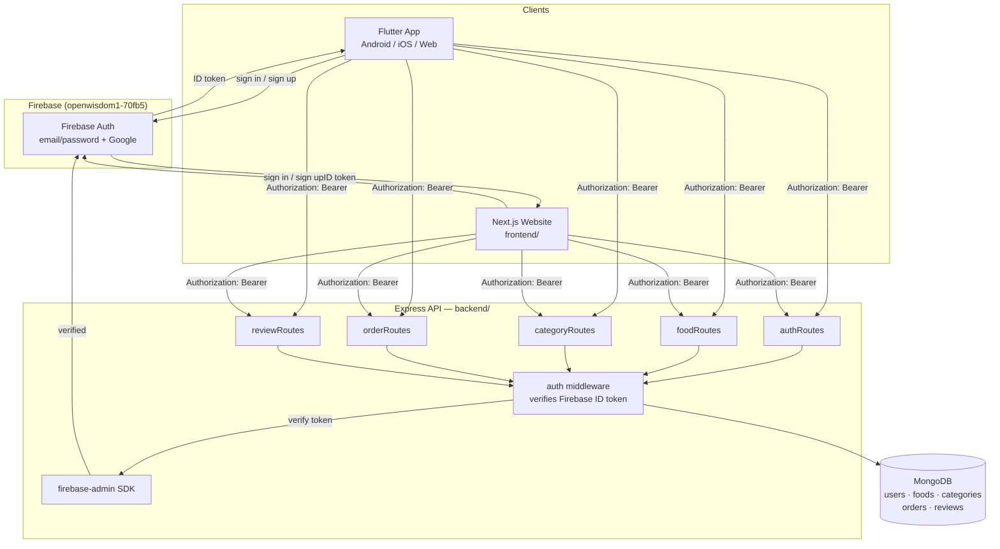
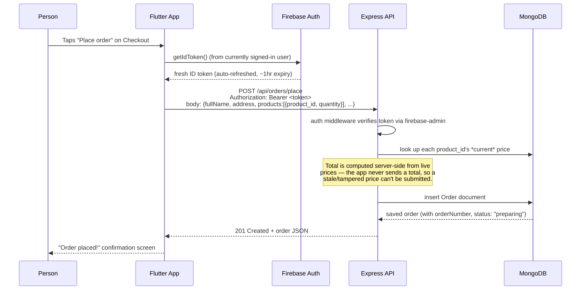
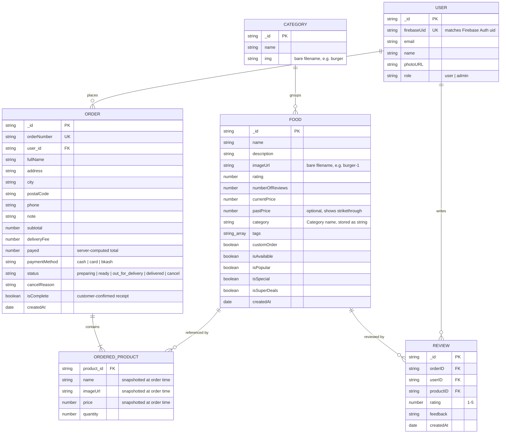
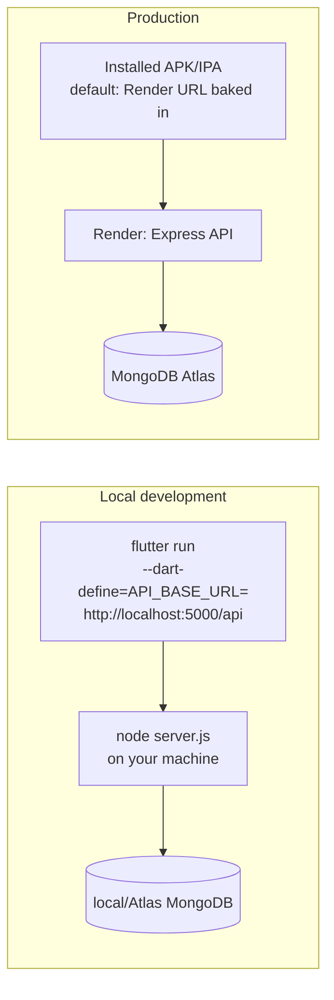
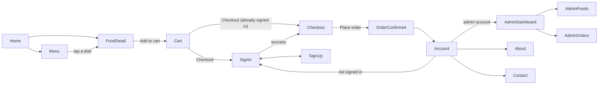

# YumTreat — Flutter app

This is a Flutter/Dart rebuild of the YumTreat website, talking to the **same**
Express/MongoDB/Firebase backend in `backend/` — same routes, same models,
same auth (Firebase ID tokens, no JWT), same order/food/review logic. Nothing
here is a mockup: every screen calls a real endpoint from your existing API.

## 0. Scaffold the native platform folders (one-time)

This project was generated as source only — `lib/`, `pubspec.yaml`,
`assets/` — without the native `android/`, `ios/`, `web/` runner folders,
since Flutter's SDK/tooling wasn't available in the environment that
generated it. Before anything else, run this **once** from this folder:

```bash
flutter create --platforms=android,ios .
```

This fills in the missing native projects around the existing `lib/` and
`pubspec.yaml` without touching them. Add `,web` to `--platforms` if you
also want a web build. If it prompts about overwriting `pubspec.yaml` or
files in `lib/`, say no / skip — you want to keep the ones already here.

## 1. Install Flutter

If you don't have it yet: https://docs.flutter.dev/get-started/install

Then, from this folder:

```bash
flutter pub get
```

## 2. Point the app at your backend

By default the app calls `http://10.0.2.2:5000/api`, which is the special
address an **Android emulator** uses to reach `localhost` on your computer.
Change this for your setup:

| Where you're running the app | `API_BASE_URL` to use |
|---|---|
| Android emulator | `http://10.0.2.2:5000/api` (default, no change needed) |
| iOS simulator | `http://localhost:5000/api` |
| Real phone (same Wi-Fi as your computer) | `http://<your-computer's-LAN-IP>:5000/api` |
| Deployed backend | `https://your-api-domain.com/api` |

Run with an override instead of editing code:

```bash
flutter run --dart-define=API_BASE_URL=http://192.168.1.20:5000/api
```

Also make sure your backend's `CORS_ORIGIN` / server config allows requests
from wherever the app runs from (mobile apps aren't subject to browser CORS,
but double check `backend/.env`'s `CORS_ORIGIN` doesn't block anything else
you're testing with, e.g. Flutter web).

## 3. Firebase setup (important)

Your backend authenticates via Firebase ID tokens (see
`backend/src/middleware/auth.js` — no JWT). The Flutter app needs to be
registered with the **same Firebase project** (`openwisdom1-70fb5`) to mint
those tokens.

`lib/firebase_options.dart` was generated by hand from your website's Firebase
**web** config (`frontend/.env`) — that project currently only has a web app
registered, no Android/iOS app. This is enough to get email/password sign-in
working immediately, but for a fully correct, production-ready native setup
(and for Google Sign-In to work reliably on Android/iOS), run:

```bash
dart pub global activate flutterfire_cli
flutterfire configure --project=openwisdom1-70fb5
```

This registers real Android/iOS apps in your Firebase console, downloads
`google-services.json` / `GoogleService-Info.plist` into the right native
folders, and regenerates `lib/firebase_options.dart` for you. Also add your
debug/release SHA-1 fingerprints in the Firebase console under
Project settings → your Android app, or Google Sign-In will fail on Android.

Admin access is unchanged from the website: whichever emails are listed in
`backend/.env`'s `ADMIN_EMAILS` get auto-promoted to the `admin` role on
their first sign-in — sign into the app with one of those emails to see the
Admin dashboard tab.

## 4. Run it

```bash
flutter run
```

## 5. App icon (what shows after someone installs the app)

Your real YumTreat logo is already in the project at
`assets/icon/app_icon.png`, and `pubspec.yaml` is configured to generate
every Android/iOS icon size from it automatically via the
`flutter_launcher_icons` package. Run this once (after `flutter pub get`,
and any time you replace the logo file):

```bash
dart run flutter_launcher_icons
```

This writes real icon files into `android/app/src/main/res/mipmap-*/` and
`ios/Runner/Assets.xcassets/AppIcon.appiconset/` — the same place
`flutterfire configure` and `flutter create` put their generated files, so
it plays nicely with everything else in this README. After running it,
just `flutter run` (or build) as normal and the new icon shows up on the
home screen / app switcher.

To change the app's *display name* (the text under the icon) from the
default "yumtreat":
- **Android**: edit `android:label="yumtreat"` in
  `android/app/src/main/AndroidManifest.xml` → change to `"YumTreat"`.
- **iOS**: edit `CFBundleDisplayName` in `ios/Runner/Info.plist` → set to
  `YumTreat` (add the key if it isn't already there).


## What's included

- **Firebase Auth** (email/password + Google) — no JWT anywhere, exactly
  like `frontend/context/AuthContext.jsx`.
- **Menu** — search, category filter, sort, matching `/api/foods` +
  `/api/categories`.
- **Food detail** — add to cart, star ratings, reviews
  (`/api/reviews/product/:id`, `/api/reviews/add-review`).
- **Cart** — local, persisted with `shared_preferences` (mobile equivalent
  of the website's `localStorage` cart).
- **Checkout** — places a real order via `/api/orders/place`; the server
  (not the app) computes the final total from live prices, same as the site.
- **Account / order history** — `/api/orders/my-orders`, cancel a
  `preparing` order, confirm receipt of a `delivered` order.
- **Admin** (visible only to admin accounts): dashboard stats, full menu
  CRUD (`/api/foods/add|update|delete`), and order management with status
  updates (`/api/orders/admin`, `/api/orders/update-status/:id`).
- **About / Contact** — reachable from the Account tab. Note: the site's
  contact form doesn't call any backend route either (there's no
  `/api/contact` in `backend/src/routes`), so this mirrors that — it's a
  local confirmation, not a fake network call. Wire it to a real endpoint
  if you add one.

## Notes / known gaps to revisit

- `lib/firebase_options.dart` uses your web app's `apiKey`/`appId` for
  Android/iOS as a stopgap — see step 3, run `flutterfire configure` for a
  proper setup.
- Food/category images were copied in as bundled assets from
  `frontend/public/images`. If you add new dishes from the admin screen with
  an `imageUrl` that doesn't have a matching file in `assets/images/foods/`,
  the app falls back to a placeholder icon — either bundle the new image and
  rebuild, or switch `FoodImage` in `lib/widgets/food_image.dart` to load
  from a URL/CDN instead of local assets if you'd rather manage images
  outside the app bundle.
- No push notifications, no payment gateway integration (the "card"/"bkash"
  options are recorded the same way the website records them — as a label
  on the order — since the backend doesn't process payments itself).

---

## Architecture overview

Three independent pieces, talking over plain HTTPS/REST — the Flutter app
is just another client of the same backend the website already uses, not a
separate system with its own logic.



**Why this matters for how you develop:** the Flutter app has zero backend
logic of its own — no local database, no business rules duplicated. Every
screen is: call an endpoint → render the JSON. If you ever change a rule
(say, how delivery fee is calculated), you only ever change it in
`backend/src/controllers/`, and both the website and the app pick it up
automatically.

## Request flow (a concrete example: placing an order)



Every other write (add review, update order status, add/edit/delete a
food) follows this same shape: Flutter attaches the Firebase ID token →
Express verifies it → Express is the only thing that talks to MongoDB.

## Database schema



Two schema details worth knowing, since they're easy to get wrong if you
extend the backend:
- **`Food.category` stores the category *name* as a plain string**, not a
  MongoDB ObjectId reference to `Category`. So renaming a category in the
  `categories` collection does *not* automatically update existing foods —
  you'd need to update both.
- **`Order.products` snapshots each item's name/image/price at the moment
  the order was placed.** If you later edit or delete that Food, past
  orders still show what the customer actually saw and paid — they don't
  retroactively change.

## API reference

Base URL: `{API_BASE_URL}` (e.g. `https://yum-treat.onrender.com/api` in
production, `http://localhost:5000/api` in local dev — see "Point the app
at your backend" above). 🔒 = requires `Authorization: Bearer <Firebase ID
token>`. 🔒👑 = also requires the signed-in user's `role` to be `admin`.
Every error response, from any endpoint, has the same shape:
`{ "message": "human-readable reason" }`, with a matching HTTP status code
(400 validation, 401 no/bad token, 403 not admin, 404 not found).

### Auth

**`GET /auth/account`** 🔒
Syncs/reads the caller's profile. There's no separate register endpoint —
`requireAuth` middleware provisions a local `User` record automatically on
a new Firebase account's first authenticated request, and auto-promotes to
`admin` if the email is in `ADMIN_EMAILS`.
```jsonc
// 200 OK
{ "profileDetails": { "id": "...", "firebaseUid": "...", "email": "a@b.com", "name": "Alex", "photoURL": "", "role": "user" } }
```

### Foods

**`GET /foods`** — all foods, newest first.
**`GET /foods/:id`** — one food, or `404`.
**`POST /foods/add`** 🔒👑 — body is any subset of the `Food` schema fields (see ER diagram below); returns the created doc, `201`.
**`PUT /foods/update/:id`** 🔒👑 — partial update, returns the updated doc.
**`DELETE /foods/delete/:id`** 🔒👑 — returns `{ "message": "Food item deleted", "_id": "..." }`.

### Categories

**`GET /categories`** — all categories, creation order.

### Orders

**`POST /orders/place`** 🔒 — the important one: **the client never sends
prices or a total.** It sends only `product_id` + `quantity` pairs; the
server looks up each food's *current* `currentPrice`/`isAvailable` in
MongoDB, rejects the request (`400`) if anything is unavailable or no
longer exists, and computes `subtotal`/`payed` itself (delivery fee is a
fixed server-side constant, `$2.99`, not something the client can
override).
```jsonc
// Request
{
  "fullName": "Alex Doe", "address": "12 Main St", "city": "Food City",
  "postalCode": "10001", "phone": "+1555...", "note": "Ring twice",
  "paymentMethod": "cash", // cash | card | bkash
  "products": [ { "product_id": "664f...", "quantity": 2 } ]
}
// 201 Created — full Order document, including server-computed fields:
{
  "_id": "...", "orderNumber": "YT-M3K2A091",
  "products": [ { "product_id": "664f...", "name": "Chicken Masala", "imageUrl": "chicken-masala", "price": 11.49, "quantity": 2 } ],
  "subtotal": 22.98, "deliveryFee": 2.99, "payed": 25.97,
  "status": "preparing", "isComplete": false, "cancelReason": ""
}
```

**`GET /orders/my-orders`** 🔒 — the caller's own orders, newest first.

**`GET /orders/admin?status=&search=&from=&to=&page=&limit=&sort=`** 🔒👑
```jsonc
// 200 OK
{ "orders": [ /* Order[] */ ], "pagination": { "page": 1, "limit": 20, "total": 143, "pages": 8 } }
```
`sort` is one of `newest` (default) | `oldest` | `highest_total` | `lowest_total`. `search` matches `fullName`, `phone`, or `orderNumber`.

**`GET /orders/admin/stats`** 🔒👑
```jsonc
// 200 OK
{
  "statusCounts": { "preparing": 4, "ready": 1, "out_for_delivery": 2, "delivered": 130, "cancel": 6 },
  "totalOrders": 137, "totalRevenue": 3182.41, "ordersToday": 9
}
```
`totalRevenue`/`totalOrders` exclude cancelled orders.

**`PATCH /orders/update-status/:id`** 🔒👑 — body `{ "status": "...", "cancelReason": "..." }` (`cancelReason` only used when status is `cancel`). Rejects (`400`) if the order is already `delivered` or `cancel` — those are terminal states.

**`PATCH /orders/cancel/:id`** 🔒 — customer cancels *their own* order. Body `{ "reason": "..." }` (optional). Only allowed while status is still `preparing` — `400` otherwise.

**`PATCH /orders/complete/:id`** 🔒 — customer confirms receipt. Only allowed while status is `delivered` — sets `isComplete: true`.

### Reviews

**`GET /reviews/product/:productID`** 🔒 — all reviews for one dish, newest first.
**`GET /reviews/user/:userID`** 🔒 — all reviews a specific user wrote.
**`POST /reviews/add-review`** 🔒
```jsonc
// Request — all four fields are required by the backend
{ "orderID": "...", "productID": "664f...", "rating": 5, "feedback": "Great!" }
// 201 Created — and the food's aggregate `rating`/`numberOfReviews` are recomputed server-side
{ "_id": "...", "orderID": "...", "userID": "...", "productID": "664f...", "rating": 5, "feedback": "Great!" }
```
⚠️ Two real backend quirks worth knowing, both mirrored as-is rather than
silently "fixed" in this app, since the goal is parity with your actual
live backend:
1. **Viewing reviews for a dish requires being signed in** (`requireAuth`
   on `GET /reviews/product/:id`), even though nothing about "what do
   people think of this dish" seems like it should need an account. In
   practice: `FoodDetailScreen` fetches reviews unconditionally, and for a
   signed-out visitor that call 401s and gets swallowed — they'll see "No
   reviews yet" even on a dish with plenty of reviews. If you want reviews
   to be genuinely public, that's a one-line backend change
   (drop `requireAuth` from that specific route in `reviewRoutes.js`).
2. The website's own review form only ever sends `productID`, `rating`,
   `feedback` (no `orderID`), even though the controller requires all
   four — `ReviewService.addReview()` in this app mirrors that same gap.
   Submitting a review will currently `400` until either the backend
   relaxes the requirement or the client is wired to actually pass a real
   `orderID` (e.g. from the order the dish was purchased in).

| Method | Endpoint | Auth |
|---|---|---|
| GET | `/auth/account` | 🔒 |
| GET | `/foods` | — |
| GET | `/foods/:id` | — |
| POST | `/foods/add` | 🔒👑 |
| PUT | `/foods/update/:id` | 🔒👑 |
| DELETE | `/foods/delete/:id` | 🔒👑 |
| GET | `/categories` | — |
| POST | `/orders/place` | 🔒 |
| GET | `/orders/my-orders` | 🔒 |
| GET | `/orders/admin` | 🔒👑 |
| GET | `/orders/admin/stats` | 🔒👑 |
| PATCH | `/orders/update-status/:id` | 🔒👑 |
| PATCH | `/orders/cancel/:id` | 🔒 |
| PATCH | `/orders/complete/:id` | 🔒 |
| GET | `/reviews/product/:id` | 🔒 |
| GET | `/reviews/user/:id` | 🔒 |
| POST | `/reviews/add-review` | 🔒 |

## System design

### Component responsibilities

| Layer | Owns | Does *not* own |
|---|---|---|
| Flutter app (`lib/`) | Rendering, navigation, local cart state, form validation | Pricing, auth verification, persistence, business rules |
| Firebase Auth | Identity — who is this person, is their session valid | What they're allowed to *do* (that's `role`, decided server-side) |
| Express API (`backend/src/`) | All business rules, token verification, the *only* thing that talks to MongoDB | Nothing gets to skip it — there is no direct client→DB path |
| MongoDB | Durable storage | — |

This is a deliberate design constraint carried over unchanged from the
website: **the Flutter app is a thin client.** It never computes a price,
never decides if an order is valid, never trusts its own cached copy of
anything over what the server just returned. That's why `placeOrder()`
sends `product_id`+`quantity` pairs and nothing else — see the sequence
diagram above.

### State management

- **`AuthProvider`** (`lib/providers/auth_provider.dart`) — wraps
  `FirebaseAuth.instance.idTokenChanges()`. This stream fires on sign-in,
  sign-out, *and* silent token refreshes (~hourly), so `AuthProvider`
  doubles as the single source of truth for "is someone signed in" across
  every screen via `context.watch<AuthProvider>()`.
- **`CartProvider`** (`lib/providers/cart_provider.dart`) — plain
  in-memory list, mirrored to `SharedPreferences` on every mutation. Cart
  survives an app restart; it is **not** synced to the backend until
  checkout — there's no server-side "cart" concept, matching the website.
- Screen-local state (loading/error/data for a single screen's fetch) is
  kept in each `StatefulWidget`, not lifted into a global provider — e.g.
  `MenuScreen`'s food list, `AccountScreen`'s order list. This avoids a
  global "app state" god-object; only things genuinely shared across many
  screens (auth, cart) are providers.

### Security model

- The app **never stores a password or long-lived credential itself** —
  `firebase_auth` handles the whole login flow and hands back a short-lived
  ID token (~1hr), refreshed silently by the SDK.
- Every authenticated API call fetches a **fresh token right before the
  request** (`ApiClient`'s Dio interceptor calls `user.getIdToken()` each
  time) rather than caching one, so a just-refreshed or just-revoked token
  is always what's actually sent.
- **Role checking happens only on the server.** `req.user.role` is decided
  by `requireAuth` middleware reading `ADMIN_EMAILS`+the stored `User`
  document — never trusted from anything the client sends. The Flutter
  app's `AdminGuard` widget hides admin screens from non-admins for UX
  purposes only; it is not a security boundary (the real boundary is
  🔒👑 on the backend routes above, which reject non-admin tokens
  regardless of what the app's UI shows).
- Firebase service-account credentials (`FIREBASE_PRIVATE_KEY` etc.) live
  **only** in `backend/.env`, never in this Flutter project — see the
  Admin SDK vs Client SDK distinction covered earlier in this
  conversation. The Flutter app only ever holds the public web API key.

### Error handling

`guardApi()` (`lib/services/api_client.dart`) wraps every network call:
a failed request becomes an `ApiException` carrying the backend's
`{ message }` string (falling back to a generic message if the response
isn't JSON, e.g. a network drop or CORS failure). Every screen's `catch`
block just displays `e.toString()` — there's one error-shape contract
across the whole app, rather than each screen parsing Dio exceptions
differently.

### Deployment topology



The switch between these two is exactly the `API_BASE_URL` mechanism
covered earlier: no flag → production default in the compiled app;
`--dart-define` → local override, dev-only.

### Project structure

```
lib/
├── main.dart                 # Entry point: Firebase init, providers, MaterialApp
├── firebase_options.dart     # Platform Firebase config
├── theme/app_theme.dart      # Colors/typography matching the website
├── models/                   # Plain Dart classes mirroring Mongoose schemas
├── services/                 # One class per backend resource; only place Dio is used
├── providers/                # AuthProvider, CartProvider (see State management above)
├── widgets/                  # Reusable pieces: FoodCard, CategoryStrip, status badges…
└── screens/
    ├── admin/                # Gated by AdminGuard
    └── *.dart                # One file per screen, matching the screen map above
```

### Non-functional notes

- **Offline behavior**: the cart works offline (local storage); everything
  else (menu, checkout, orders) requires connectivity and fails with a
  visible error state rather than silently retrying — there's no offline
  queue or background sync in this version.
- **Scalability**: since the app holds no business logic, scaling the
  system means scaling the Express API / MongoDB independently of how many
  app installs exist — the app itself has no server-side footprint at all.
- **Not implemented** (flagged honestly, not silently skipped): push
  notifications, real payment gateway processing (card/bKash are recorded
  as labels only, per the "Notes / known gaps" section above), offline
  request queueing.

## App screen map



## Screenshots

> **Heads up:** these are placeholders. I generated the diagrams above
> directly, but I don't have a way to render your running Flutter app and
> capture real screenshots — that only exists once you run it on your own
> machine. Run the app, take a screenshot of each screen below (any method
> — phone screenshot, emulator screenshot, or your OS's snipping tool),
> save each into the `screenshots/` folder using the filename listed, and
> every image below will render automatically wherever this README is
> viewed (GitHub, GitLab, etc.).

| Screen | Filename | Preview |
|---|---|---|
| Home | `screenshots/01-home.png` |  |
| Menu | `screenshots/02-menu.png` |  |
| Food detail | `screenshots/03-food-detail.png` |  |
| Cart | `screenshots/04-cart.png` |  |
| Sign in | `screenshots/05-signin.png` |  |
| Checkout | `screenshots/06-checkout.png` |  |
| Order confirmed | `screenshots/07-order-confirmed.png` |  |
| Account / order history | `screenshots/08-account.png` |  |
| Admin dashboard | `screenshots/09-admin-dashboard.png` |  |
| Admin — manage foods | `screenshots/10-admin-foods.png` |  |
| Admin — manage orders | `screenshots/11-admin-orders.png` |  |
| About | `screenshots/12-about.png` |  |

The `screenshots/` folder already exists in this project (currently
empty) — just drop your PNGs/JPGs in with the exact filenames above and
these tables go live with no other changes needed.

